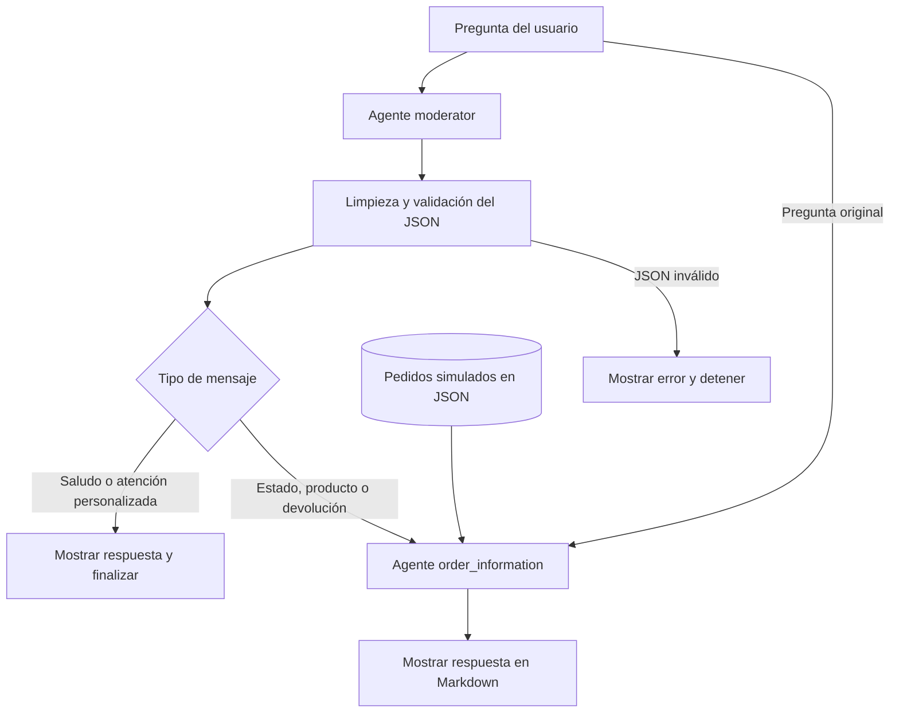

# Taller 1 — Inteligencia Artificial Generativa

**Asignatura:** Inteligencia Artificial Generativa  
**Autor:** Jose Milciades Ordoñez Argote

---

# Fase 1: Selección y justificación del modelo de IA

## Modelo seleccionado

Para desarrollar la solución de atención al cliente de EcoMarket se seleccionó **Gemini 2.5 Flash-Lite**, un modelo de lenguaje de propósito general que se utilizará como parte de una arquitectura híbrida.

El modelo se encargará de comprender las consultas y redactar respuestas claras, mientras que la información concreta sobre pedidos, productos y políticas se obtendrá de fuentes autorizadas de EcoMarket. De esta forma, Gemini no será la fuente oficial de los datos, sino el componente encargado de interpretarlos y comunicarlos al cliente.

## Justificación de la selección

Gemini 2.5 Flash-Lite fue seleccionado porque ofrece una relación adecuada entre costo, velocidad y calidad para consultas breves y repetitivas. Google lo describe como un modelo orientado a tareas de alto volumen, clasificación, extracción de datos y aplicaciones que requieren baja latencia. También admite llamadas a funciones y respuestas estructuradas, características útiles para conectarlo con los servicios de EcoMarket.

Durante las pruebas también se evaluaron modelos que podrian desplegarse localmente, entre ellos groq_qwen_3_8_27b. Aunque sus respuestas fueron satisfactorias, llevar estos modelos a producción exigiría recursos propios para inferencia, servidores con capacidad suficiente, configuración, monitoreo, actualizaciones y disponibilidad continua.

El uso de Gemini permite comenzar con un esquema de pago por consumo y evita una inversión inicial alta en infraestructura. También permite ajustar la capacidad de atención según el volumen de solicitudes, lo cual resulta apropiado para una empresa que recibe miles de consultas diarias.

Las pruebas efectuadas mostraron que su precisión y velocidad son suficientes para responder preguntas generales sobre productos y consultas particulares relacionadas con pedidos, siempre que el modelo reciba información actualizada desde los sistemas de EcoMarket.

## Arquitectura propuesta

La solución se organiza en dos agentes: **`moderator`** y **`order_information`**. Cada agente combina un prompt especializado con el modelo Gemini definido en el cuaderno, mediante LangChain. El primero identifica la intención del usuario y el segundo prepara la respuesta sobre pedidos y productos.

### Agente moderator

El agente `moderator` recibe la pregunta del usuario y la clasifica como consulta de estado del pedido (`order_status`), información del producto (`product_information`), solicitud de devolución (`order_return`), saludo (`greeting`) o atención personalizada (`personalized_attention`). Si el mensaje contiene varias intenciones, prioriza devolución, estado del pedido e información del producto sobre el saludo.

Devuelve un JSON con dos propiedades: `message_type` y `expanded_response`. Esta última contiene el saludo o una breve justificación de la clasificación. Antes de continuar, el flujo extrae el JSON con `clean_json` y valida su estructura y los valores permitidos.

Cuando la clasificación es saludo o atención personalizada, se muestra la respuesta y termina la consulta. En esta versión, la atención personalizada es una clasificación; el contacto efectivo con un asesor se incorporará en una etapa posterior.

### Agente order_information

El agente `order_information` recibe la pregunta original, el tipo de mensaje y el listado de pedidos. Con esos datos responde sobre el estado de entrega, las características disponibles del producto o la elegibilidad para devolución. Su salida se presenta como Markdown.

Para pedidos retrasados, comunica la fecha inicial de entrega, los días de atraso, la fecha estimada actualizada, el número de seguimiento y su enlace. Para devoluciones, aplica las reglas del prompt: no se aceptan productos de aseo general ni perecederos; para las demás categorías se informa la elegibilidad y el plazo de 20 días hábiles, sin afirmar que la devolución ya fue ejecutada. Si falta información para identificar el pedido, solicita una aclaración.

### Flujo implementado en el taller

El cuaderno implementa este flujo de forma secuencial, con datos simulados de `dataset/orders.json` y políticas incluidas en los prompts. También contiene manejo de errores y casos de prueba. No realiza operaciones comerciales ni está conectado con los sistemas reales de EcoMarket.

Las capacidades de atención continua, concurrencia, integración multicanal, autenticación y derivación humana descritas en las fases corresponden a la solución propuesta y se desarrollarán posteriormente; no son funcionalidades incluidas en esta versión del taller.

Las preguntas generales sobre productos y políticas podrán responderse mediante recuperación de información desde documentos y catálogos aprobados. Este diseño permitirá actualizar el conocimiento sin entrenar nuevamente el modelo. La recuperación documental también se implementará en una etapa futura; actualmente se proporcionan al modelo los pedidos simulados y las reglas definidas en los prompts.

### Uso de LangChain y portabilidad

La aplicación utiliza LangChain como capa de conexión con el modelo, las fuentes de datos y las herramientas del sistema. Esta biblioteca permite configurar distintos proveedores y cambiar el modelo con modificaciones controladas en la aplicación.

Esta decisión reduce la dependencia técnica de Gemini. Si cambian los costos, las condiciones contractuales o los requerimientos de calidad, se podrá evaluar otro modelo alojado en la nube o desplegado localmente. Sin embargo, un cambio de proveedor siempre exigirá nuevas pruebas de calidad, seguridad, latencia y compatibilidad.

## Decisión sobre el ajuste del modelo

PAra este taller no se ajustará un modelo con datos propios de EcoMarket. Esta decisión se debe a que la empresa probablemente todavía no cuenta con un conjunto suficiente de conversaciones revisadas, clasificadas y autorizadas para entrenamiento y por otra parte el ajuste de un modelo también generaría costos de preparación de datos, entrenamiento, evaluación y mantenimiento. Para esta etapa resulta más conveniente emplear un modelo de propósito general acompañado de instrucciones, reglas de negocio y recuperación de información desde fuentes autorizadas.

En una etapa posterior se podrá estudiar el ajuste de un modelo si las evaluaciones muestran que las instrucciones y la recuperación de información no alcanzan la calidad requerida y que que el costo beneficios es superior al usar un modelo local. Para tomar esa decisión será necesario contar con datos depurados, permisos para su uso y métricas que permitan comprobar una mejora real.

---

# Fase 2: Evaluación de fortalezas, limitaciones y riesgos éticos

## Fortalezas

La solución tiene como objetivo atender automáticamente gran parte de las consultas repetitivas que representan el 80 % de las solicitudes recibidas por EcoMarket. Este porcentaje corresponde a la distribución indicada en el caso de estudio y deberá comprobarse mediante una prueba piloto.

Entre sus principales fortalezas se encuentran:

* Reducción del tiempo de respuesta, actualmente estimado en 24 horas.
* Disponibilidad continua para atender consultas fuera del horario laboral.
* Capacidad para responder varias solicitudes al mismo tiempo.
* Respuestas más consistentes entre chat, y otros medios de comunicación.
* Consulta rápida de información sobre pedidos, productos y políticas.
* Derivación de los casos complejos a personal especializado.
* Mayor disponibilidad de los asesores para atender quejas, problemas técnicos, solicitudes especiales y situaciones que requieran empatía.

## Limitaciones

La primera versión tendrá un alcance principalmente informativo. El sistema podrá consultar y comunicar datos, pero no estará autorizado para ejecutar operaciones que puedan afectar al cliente o a la empresa.

Por lo tanto, no podrá:

* Aprobar ni efectuar devoluciones o reembolsos.
* Modificar o cancelar pedidos.
* Tomar nuevos pedidos.
* Cambiar direcciones de entrega.
* Procesar pagos.
* Resolver por sí solo quejas, problemas técnicos o situaciones que requieran negociación y empatía.
* Responder correctamente cuando los datos de origen estén incompletos, desactualizados o sean contradictorios.

El desempeño de la solución dependerá de la calidad y disponibilidad de las bases de datos y servicios conectados. Si la fuente contiene un dato incorrecto, el sistema podría comunicarlo correctamente desde el punto de vista técnico, pero la respuesta seguiría siendo equivocada para el cliente.

También existirán dependencias de conectividad y del proveedor del modelo. Por esta razón, la aplicación deberá contar con manejo de errores, registro de fallos y un mecanismo para trasladar la consulta a un asesor cuando alguno de los servicios no esté disponible.

## Riesgo de alucinaciones y respuestas incorrectas

Gemini puede generar respuestas que parezcan correctas aunque contengan información falsa. Google también advierte que sus modelos pueden producir resultados plausibles pero inexactos y recomienda validar las respuestas antes de utilizarlas.

Para reducir este riesgo se aplicarán los siguientes controles:

* Obtener los datos de pedidos directamente desde fuentes autorizadas.
* Prohibir que el modelo complete información ausente.
* Responder que no se dispone de datos suficientes cuando la consulta no pueda verificarse.
* Validar campos críticos, como número de pedido, estado, fecha estimada y enlace de seguimiento.
* Usar formatos de salida estructurados.
* Crear pruebas automatizadas con distintas formas de formular cada consulta.
* Revisar periódicamente una muestra representativa de respuestas.
* Registrar los errores detectados y ajustar las instrucciones o reglas correspondientes.
* Trasladar al personal humano los casos con información incompleta o contradictoria.

La evaluación deberá medir, al menos, la exactitud de los datos comunicados, la tasa de respuestas sin sustento, el tiempo de respuesta, el porcentaje de derivación y la proporción de consultas resueltas sin intervención humana.

## Riesgo de sesgo

El modelo puede reproducir sesgos presentes en sus datos de entrenamiento o responder de forma diferente según el nombre, idioma, forma de escritura o características percibidas del cliente.

Para controlar este riesgo, la solución no deberá asignar prioridades, beneficios o restricciones con base en características personales. Las políticas de devolución, tiempos de atención y criterios de traslado deberán aplicarse de forma consistente.

También deberán realizarse pruebas con distintas formas de comunicación para comprobar que el tono, la calidad de la respuesta y el acceso a la atención humana sean equivalentes para todos los clientes.

## Privacidad y seguridad de los datos

La solución seguirá el principio de minimización: solo enviará al modelo los datos estrictamente necesarios para responder cada consulta. No será necesario incluir el historial completo del cliente cuando la respuesta pueda generarse con el número del pedido, su estado y la fecha estimada de entrega.

La arquitectura para producción deberá incluir:

* Autenticación del cliente antes de mostrar información privada.
* Control de acceso según el perfil del usuario.
* Cifrado de la información durante su transmisión y almacenamiento.
* Ocultamiento de datos personales en registros y pruebas.
* Periodos definidos de conservación y eliminación.
* Restricción del acceso del modelo a las operaciones autorizadas.
* Protección frente a instrucciones maliciosas que intenten obtener información de otros clientes.
* Prohibición de utilizar conversaciones con datos personales para entrenamiento sin autorización y sin una evaluación previa.

Si el servicio se contrata mediante una modalidad de Google Cloud cubierta por el **Cloud Data Processing Addendum**, el tratamiento de los datos queda sujeto a obligaciones contractuales de procesamiento y seguridad. Google también indica que los datos enviados a sus productos de Gemini para Google Cloud no se utilizan para entrenar sus modelos.

El DPA no debe presentarse como una certificación ni como garantía automática de cumplimiento legal. EcoMarket seguirá siendo responsable de configurar correctamente el servicio, definir una base legal para el tratamiento, informar a los clientes, atender sus derechos y comprobar qué condiciones contractuales se aplican al servicio contratado.

## Transparencia y control humano

El cliente deberá saber que está interactuando con un sistema automatizado. También tendrá que disponer de una opción clara para solicitar atención humana.

El sistema no deberá ocultar sus limitaciones ni afirmar que realizó una operación cuando solamente proporcionó información. Las decisiones que afecten pagos, devoluciones, cancelaciones o derechos del cliente permanecerán bajo control del personal autorizado.

## Impacto laboral

La capacidad de atender hasta el 80 % de las consultas repetitivas no significa que deba eliminarse el 80 % de los puestos de atención al cliente. El objetivo es redistribuir el trabajo y permitir que el personal dedique más tiempo a actividades que requieren experiencia, análisis y comunicación personalizada.

Los asesores podrán concentrarse en:

* Atender casos complejos.
* Gestionar quejas y situaciones sensibles.
* Supervisar una muestra de las respuestas automáticas.
* Corregir información y reportar fallos.
* Mejorar las políticas y contenidos usados por el sistema.
* Atender tareas acumuladas durante los periodos de mayor demanda.
* Identificar problemas frecuentes en los procesos de compra, entrega y devolución.

La empresa deberá ofrecer formación para que los trabajadores comprendan el funcionamiento, los límites y los procedimientos de supervisión del sistema. También deberá comunicar con claridad los cambios en sus funciones y evitar evaluar su desempeño únicamente mediante métricas generadas por la herramienta.

## Seguimiento y responsabilidad

La solución deberá contar con responsables definidos para su operación, seguridad y calidad. Además, será necesario establecer un procedimiento para suspender respuestas automáticas, corregir errores, atender incidentes de privacidad y comunicar fallos que hayan afectado a los clientes.

Antes de ampliar su uso, EcoMarket deberá realizar una prueba piloto y comparar sus resultados con la atención actual. La automatización solo deberá extenderse cuando las mediciones demuestren que las respuestas son correctas, seguras y útiles para los clientes.

---

## Fase 3: Aplicación de la Ingeniería de Prompts

El tercer punto se encuentra desarrollado en el cuaderno [taller_1.ipynb](taller_1.ipynb).
