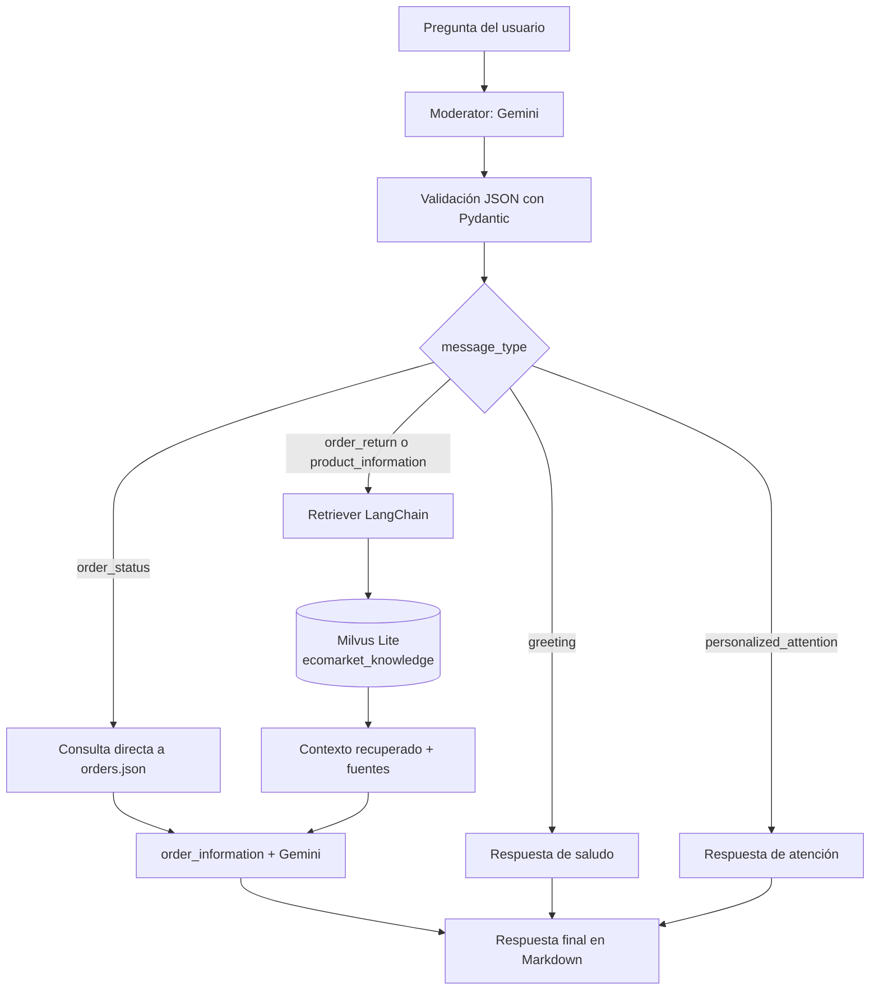

# Taller práctico 2: RAG para EcoMarket

**Asignatura:** Inteligencia Artificial Generativa  
**Autor:** Jose Milciades Ordoñez Argote  
**Cuaderno:** [`taller_2.ipynb`](taller_2.ipynb)

Este documento describe la solución del segundo taller. Se extiende el flujo del taller 1 con recuperación aumentada por generación (RAG): los documentos de conocimiento se convierten en embeddings, se almacenan en Milvus y se recuperan antes de solicitar al modelo una respuesta para las consultas que requieren información documental.

## Fase 1. Selección de los componentes RAG

### ¿Qué modelo de embeddings se seleccionó?

Se seleccionó **`BAAI/bge-m3`**, cargado mediante `HuggingFaceEmbeddings` de LangChain. Es un modelo abierto, multilingüe y adecuado para textos en español. Se ejecuta localmente en el entorno de Python, por lo que no se envía el contenido de la base de conocimiento a un servicio externo ni se paga una llamada por cada embedding.

La elección representa un equilibrio entre precisión, costo y control:

| Alternativa | Ventajas | Costos o limitaciones |
|---|---|---|
| `BAAI/bge-m3` (seleccionada) | Abierta, reproducible, multilingüe y sin costo por token | Descarga el modelo y consume memoria/CPU; el rendimiento debe medirse con datos reales |
| Embeddings propietarios | Operación administrada y, en algunos casos, muy buen rendimiento | Dependencia de API, cuotas, costo por uso y envío de los documentos |

La dimensionalidad y la calidad de la representación deben evaluarse con un conjunto de preguntas reales de EcoMarket. Para una aplicación productiva se recomienda comparar esta opción con un embedding administrado usando precisión de recuperación, latencia y costo.

### ¿Qué base de datos vectorial se seleccionó?

Se seleccionó **Milvus**, utilizando **Milvus Lite** a través de `pymilvus` y la integración `langchain-milvus`. En el cuaderno la colección `ecomarket_knowledge` queda persistida en `dataset/milvus_lite.db`.

Milvus Lite es apropiado para el taller porque puede ejecutarse dentro de Jupyter con un archivo local y ofrece búsqueda por similitud, persistencia, filtros de metadatos y operaciones CRUD. La misma API permite pasar posteriormente a Milvus Standalone, Milvus Distributed o Zilliz Cloud cambiando la URI y las credenciales. Esto facilita escalar sin rediseñar la cadena de LangChain. La documentación oficial describe esta compatibilidad entre Lite, Standalone y Distributed en [Run Milvus Lite Locally](https://milvus.io/docs/milvus_lite.md).

| Opción considerada | Escalabilidad | Costo y operación | Ajuste para este taller |
|---|---|---|---|
| **Milvus Lite (seleccionada)** | Prototipo local; permite migrar a Standalone/Distributed | Sin servicio adicional en local; requiere administrar el archivo | Muy buena para Jupyter y una futura migración |
| ChromaDB | Sencillo para prototipos locales | Operación simple, pero el escalamiento depende del despliegue elegido | Adecuado para demos pequeñas |
| Pinecone | Servicio administrado y escalamiento gestionado | Costos, cuotas y dependencia del proveedor | Útil si se prioriza operación cloud |
| Weaviate | Servicio completo, filtros e integraciones | Mayor complejidad de despliegue que Lite | Útil para una plataforma desplegada |

La ventaja principal de Milvus para EcoMarket es separar el código de la aplicación del modo de despliegue: en desarrollo se usa un archivo local; cuando aumentan los documentos, usuarios o vectores, la colección puede alojarse en un servidor o clúster. Milvus está diseñado para almacenar embeddings y ejecutar búsquedas de similitud; su documentación presenta la arquitectura y los componentes de despliegue en [Milvus Architecture Overview](https://milvus.io/docs/architecture_overview.md). Milvus Lite sigue siendo una opción para conjuntos pequeños; la documentación recomienda Standalone o Distributed para grandes volúmenes.

## Fase 2. Construcción de la base de conocimiento

### Documentos incluidos

La carpeta [`dataset/knowledge_base`](dataset/knowledge_base) contiene los tres tipos de fuente solicitados:

1. **`Política Integral de Devoluciones y Garantías - EcoMarket.pdf`**: reglas de cambios, devoluciones y garantías.
2. **`Preguntas_Frecuentes_EcoMarket.csv`**: preguntas y respuestas frecuentes.
3. **`Catalogo_Productos_Ecologicos.csv`**: información del catálogo y sus productos.

El archivo [`dataset/orders.json`](dataset/orders.json) se conserva para resolver directamente `order_status`. Se excluye intencionalmente de Milvus porque representa datos transaccionales que deben consultarse por identificador, no mediante similitud semántica.

### Estrategias de chunking

Se usan dos estrategias, según la estructura de cada fuente. El criterio general es conservar el **contexto completo de la unidad consultable**: los textos y registros son suficientemente pequeños para recuperar sus datos completos en un solo chunk, evitando dividir información que debería interpretarse junta.

- **PDF de política:** se extrae el texto por página y se aplica `RecursiveCharacterTextSplitter` con `chunk_size=1000` y `chunk_overlap=200`. Cada fragmento mantiene el contexto de la regla o sección que contiene; el solapamiento conserva información adicional cuando una regla queda dividida entre dos fragmentos.
- **Archivos CSV:** cada fila es un chunk completo. Como cada registro es pequeño, sus datos se obtienen completos en un único chunk. Antes de vectorizarla se antepone el nombre de cada columna al valor, con el formato `columna: valor`, y se separan los campos por saltos de línea. Así el embedding conserva el significado de todos los campos del registro.

La ejecución actual valida **10 chunks del PDF** y **30 registros/chunks de CSV**, para un total de **40 chunks**. Cada documento conserva metadatos de origen, tipo, página y fila para mostrar las fuentes recuperadas.

### Indexación

El proceso implementado en el cuaderno es:

1. Leer el PDF y los CSV.
2. Aplicar la estrategia de chunking correspondiente.
3. Generar un vector por chunk con `BAAI/bge-m3` y normalizar sus embeddings.
4. Insertar los textos, vectores y metadatos en la colección `ecomarket_knowledge` de Milvus.
5. Crear un retriever de LangChain con `k=4` para recuperar los fragmentos más relevantes.

## Fase 3. Integración con el flujo del taller 1

El cuaderno integra la recuperación sin crear un archivo Python adicional. Se mantienen los agentes y prompts de LangChain, y se agrega la consulta a Milvus únicamente cuando el moderador clasifica la pregunta como `order_return` o `product_information`.

La separación de responsabilidades queda así:

- **Moderator:** clasifica la intención y extrae el número de orden cuando existe.
- **Milvus retriever:** recupera contexto documental para devoluciones y productos.
- **`orders.json`:** mantiene la consulta exacta del estado de una orden.
- **`order_information_agent`:** recibe la orden, el tipo de consulta y el contexto recuperado; luego genera la respuesta con Gemini.

Las pruebas automáticas incluidas en el cuaderno comprueban que `order_return` y `product_information` usan Milvus, que `order_status` usa `orders.json` y que `greeting` y `personalized_attention` terminan sin una búsqueda vectorial. Las pruebas usan respuestas simuladas para validar el enrutamiento sin consumir cuota del modelo.

## Supuestos y limitaciones

- La implementación actual usa Milvus Lite y un archivo local; todavía no es un despliegue distribuido de producción.
- El modelo `BAAI/bge-m3` se descarga y ejecuta localmente en CPU. La latencia y el consumo de memoria pueden aumentar al crecer la colección.
- Si cambian los documentos, se debe volver a ejecutar la celda de carga e indexación para reconstruir la colección.
- El retriever usa los cuatro resultados más cercanos (`k=4`); todavía no se aplica un umbral de relevancia ni un reranker.
- `orders.json` es un conjunto de datos de demostración. Un sistema real debe reemplazarlo por una fuente transaccional con autenticación y control de acceso.
- Las respuestas dependen de la disponibilidad, cuota y configuración del modelo Gemini definido en el archivo `.env`.

## Trabajo futuro

Como siguiente etapa se puede desplegar la colección en Milvus Standalone, Distributed o Zilliz Cloud, añadir filtros por tipo de documento, medir recuperación con un conjunto de evaluación, incorporar un reranker y automatizar la reindexación cuando se actualice la base de conocimiento. La documentación de Milvus Lite explica que el mismo patrón de cliente puede conectarse a esos despliegues, aunque las capacidades y límites de Lite no sustituyen una configuración de producción.

## Ejecución

1. Activar el entorno `icesi_ia_generativa` con Python 3.12.
2. Configurar `GOOGLE_API_KEY` en `.env`.
3. Abrir `taller_2.ipynb` y ejecutar las celdas en orden.
4. Ejecutar las celdas de validación de RAG, pruebas de enrutamiento y pruebas automáticas.

La instalación de dependencias, la carga documental, la creación de embeddings, la indexación, el retriever y las pruebas quedan documentados y ejecutables dentro del cuaderno.
